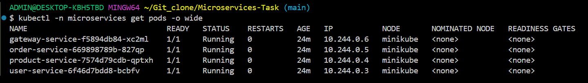
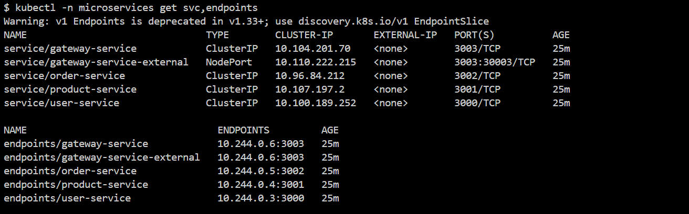
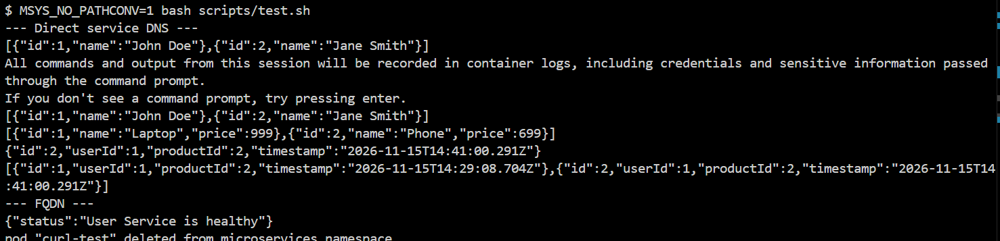
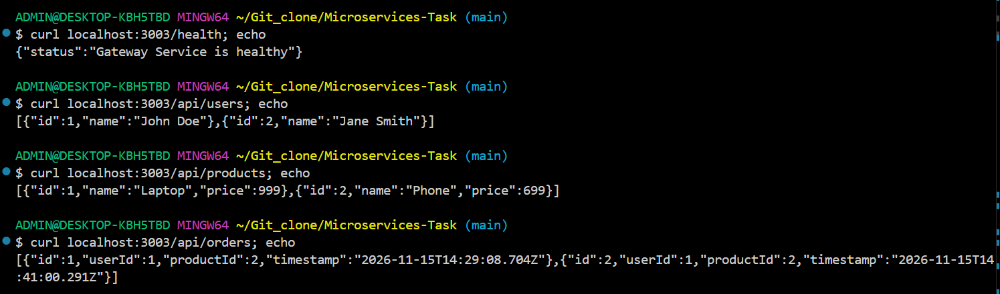
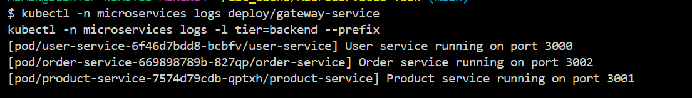

# Microservices Deployment on Kubernetes (Minikube)

Four Node.js/Express microservices deployed on a local Minikube cluster. Each service has a Deployment with resource limits, environment variables, liveness/readiness probes and labels, plus a ClusterIP Service so the services can find each other through cluster DNS.

---

## 1. Architecture

| Service | Port | Endpoints | Depends on |
|---|---|---|---|
| user-service | 3000 | `GET /health`, `GET /users` | – |
| product-service | 3001 | `GET /health`, `GET /products` | – |
| order-service | 3002 | `GET /health`, `GET /orders`, `POST /orders` | – |
| gateway-service | 3003 | `GET /health`, `GET /api/users`, `GET /api/products`, `GET/POST /api/orders` | user, product, order |

```
                ┌──────────────── namespace: microservices ────────────────┐
                │                                                          │
 client ──────► │  gateway-service :3003   (ClusterIP + NodePort 30003)    │
 (port-forward) │        │                                                 │
                │        ├──► http://user-service:3000      (ClusterIP)    │
                │        ├──► http://product-service:3001   (ClusterIP)    │
                │        └──► http://order-service:3002     (ClusterIP)    │
                │                                                          │
                └──────────────────────────────────────────────────────────┘
```

---

## 2. Repository structure

```
Microservices-Task/
├── Microservices/
│   ├── user-service/      app.js, package.json, Dockerfile, .dockerignore
│   ├── product-service/   app.js, package.json, Dockerfile, .dockerignore
│   ├── order-service/     app.js, package.json, Dockerfile, .dockerignore
│   └── gateway-service/   app.js, package.json, Dockerfile, .dockerignore
├── k8s/
│   ├── 00-namespace.yaml          Namespace "microservices"
│   ├── 01-configmap.yaml          Shared config (NODE_ENV, LOG_LEVEL, upstream URLs, NO_PROXY)
│   ├── 10-user-service.yaml       Deployment + ClusterIP Service
│   ├── 11-product-service.yaml    Deployment + ClusterIP Service
│   ├── 12-order-service.yaml      Deployment + ClusterIP Service
│   └── 13-gateway-service.yaml    Deployment + ClusterIP Service + NodePort Service
├── scripts/
│   ├── build-images.sh            Build images with Docker and load them into Minikube
│   ├── deploy.sh                  kubectl apply + wait for rollout
│   └── test.sh                    In-cluster curl tests (direct + via gateway)
├── screenshots/
└── README.md
```

---

## 3. Design decisions

### Deployments
| Requirement | Implementation |
|---|---|
| Container image | `<service-name>:1.0`, built locally and loaded into Minikube; `imagePullPolicy: IfNotPresent` |
| Resources | requests `cpu: 50m`, `memory: 64Mi`; limits `cpu: 200m`, `memory: 128Mi` |
| Environment variables | `PORT`, `SERVICE_NAME` (inline); `NODE_ENV`, `LOG_LEVEL` from ConfigMap `microservices-config` |
| Readiness probe | `HTTP GET /health`: starts after 5s, checks every 5s, 3 failures allowed |
| Liveness probe | `HTTP GET /health`: starts after 15s, checks every 10s, 3 failures allowed |
| Labels / selectors | `app: <service-name>` (the selector), `tier: frontend/backend`, `app.kubernetes.io/part-of: microservices-task` |
| Container image hardening | `node:18-alpine` base, production dependencies only, runs as the non-root `node` user |

### Services
- All four services are **ClusterIP**, which gives each a stable virtual IP and a DNS name inside the cluster. The backends are never exposed outside the cluster.
- **The Service names match the hostnames hardcoded in the gateway code.** `gateway-service/app.js` calls `http://user-service:3000`, `http://product-service:3001` and `http://order-service:3002`. Every resource is in the same namespace, so these short names resolve through CoreDNS. The full form, `<svc>.microservices.svc.cluster.local`, also works.
- Every Service uses a named `targetPort: http` that points at the container port.
- `gateway-service-external` (a **NodePort** on 30003) is optional. It's the only way into the cluster without port-forwarding, and only the gateway gets one.

### Gateway proxy handling
The gateway reaches the other services through **axios**, and axios automatically uses any `HTTP_PROXY`/`HTTPS_PROXY` environment variables. On a corporate network those variables can make the gateway send its calls to the other services through an outside proxy, and those calls fail. To prevent that, the gateway Deployment sets:
- `NO_PROXY` / `no_proxy`, which list the service names, `.svc`, `.cluster.local`, the Service CIDR `10.96.0.0/12` and the Pod CIDR `10.244.0.0/16`
- `USER_SERVICE_URL`, `PRODUCT_SERVICE_URL`, `ORDER_SERVICE_URL`, which record the upstream addresses (from the ConfigMap)

---

## 4. Prerequisites

| Tool | Version used | Install (Windows) |
|---|---|---|
| Docker Desktop | 4.99 (Engine 29.9) | `winget install -e --id Docker.DockerDesktop` |
| Minikube | v1.39.0 | `winget install -e --id Kubernetes.minikube` |
| kubectl | v1.37 | `winget install -e --id Kubernetes.kubectl` |
| Git Bash | – | Comes with Git for Windows (the commands below use bash) |

Start Docker Desktop and wait until it shows **"Engine running"**.

Check the tools:
```bash
docker version
kubectl version --client
minikube version
```

---

## 5. Minikube setup

```bash
minikube start --driver=docker --cpus=2 --memory=3000
minikube status
kubectl get nodes          # STATUS should be Ready
```

> Docker Desktop on this machine had about 3.7 GB of memory available, so Minikube gets 3000 MB. These four services need very little.

---

## 6. Build the images

The images are built with Docker Desktop and then loaded into Minikube's image store. This works with both of Minikube's container runtimes, docker and containerd.

```bash
bash scripts/build-images.sh
```

That script does the following:
```bash
for s in user-service product-service order-service gateway-service; do
  docker build -t $s:1.0 Microservices/$s
  minikube image load $s:1.0
done
minikube image ls | grep service
```

Expected output:
```
docker.io/library/user-service:1.0
docker.io/library/product-service:1.0
docker.io/library/order-service:1.0
docker.io/library/gateway-service:1.0
```

---

## 7. Deploy with `kubectl apply -f`

```bash
kubectl apply -f k8s/
```
The files are numbered so they apply in order: the Namespace first, then the ConfigMap, then the services.

Or use the script, which also waits for every rollout to finish:
```bash
bash scripts/deploy.sh
```

Verify:
```bash
kubectl -n microservices get pods -o wide
kubectl -n microservices get svc,endpoints
kubectl -n microservices get deploy
```
All four pods should show `1/1 Running`, and each Service should have an endpoint IP.

---

## 8. Testing the services

### 8.1 By service name, from inside the cluster
```bash
MSYS_NO_PATHCONV=1 bash scripts/test.sh     # MSYS_NO_PATHCONV is only needed in Git Bash
```
The script starts a temporary `curlimages/curl` pod and calls each service by its DNS name. To do the same by hand:
```bash
kubectl -n microservices run curl-test --rm -it --restart=Never --image=curlimages/curl -- sh
curl -s http://user-service:3000/users
curl -s http://product-service:3001/products
curl -s http://order-service:3002/orders
curl -s http://gateway-service:3003/api/users
curl -s http://gateway-service:3003/api/products
curl -s -X POST -H 'Content-Type: application/json' -d '{"userId":1,"productId":2}' http://gateway-service:3003/api/orders
curl -s http://gateway-service:3003/api/orders
curl -s http://user-service.microservices.svc.cluster.local:3000/health
exit
```

### 8.2 With `kubectl port-forward`
Terminal 1:
```bash
kubectl -n microservices port-forward svc/gateway-service 3003:3003
```
Terminal 2:
```bash
curl localhost:3003/health
curl localhost:3003/api/users
curl localhost:3003/api/products
curl -X POST -H 'Content-Type: application/json' -d '{"userId":1,"productId":2}' localhost:3003/api/orders
curl localhost:3003/api/orders
```
To reach one backend directly, forward its own port, for example `kubectl -n microservices port-forward svc/user-service 3000:3000`.

### 8.3 With the NodePort (optional)
```bash
minikube service gateway-service-external -n microservices --url
curl <printed-url>/api/users
```

### 8.4 Expected responses
| Request | Response |
|---|---|
| `/api/users` | `[{"id":1,"name":"John Doe"},{"id":2,"name":"Jane Smith"}]` |
| `/api/products` | `[{"id":1,"name":"Laptop","price":999},{"id":2,"name":"Phone","price":699}]` |
| `POST /api/orders` | `{"id":1,"userId":1,"productId":2,"timestamp":"..."}` |
| `/api/orders` | `[{"id":1,"userId":1,"productId":2,"timestamp":"..."}]` |
| `/health` | `{"status":"Gateway Service is healthy"}` |

When a `/api/*` call on the gateway returns data, the gateway has resolved the backend Service by its DNS name and reached it, which proves the services can communicate.

### 8.5 Logs
```bash
kubectl -n microservices logs deploy/gateway-service
kubectl -n microservices logs -l tier=backend --prefix
kubectl -n microservices describe pod -l app=gateway-service    # probe status and events
```

---

## 9. Troubleshooting

| Symptom | Cause | Fix |
|---|---|---|
| `PROVIDER_DOCKER_NOT_FOUND` on `minikube start` | `docker.exe` isn't on the Windows PATH that Minikube sees | Add `C:\Program Files\Docker\Docker\resources\bin` to the user PATH and restart the terminal. In Git Bash: `export PATH="/c/Program Files/Docker/Docker/resources/bin:$PATH"`. Check with `cmd //c where docker`. |
| `Docker Desktop has only NNNNMB memory but you specified 4096MB` | Minikube asked for more memory than Docker Desktop has | `minikube start --memory=3000`, or raise the memory in Docker Desktop → Settings → Resources |
| `SSH_AGENT_START: starting an SSH agent on Windows is not yet supported` on `minikube docker-env` | Minikube is using the containerd runtime, and docker-env doesn't support it on Windows | Build with Docker Desktop and run `minikube image load :1.0` (see `scripts/build-images.sh`) |
| `ErrImagePull` / `ImagePullBackOff` | The image isn't in Minikube, so Kubernetes tries Docker Hub | Run `bash scripts/build-images.sh`, check with `minikube image ls`, then `kubectl -n microservices rollout restart deployment` |
| `exec format error` when running `kubectl` | A Linux `kubectl` binary is earlier on the PATH | Remove or rename it, then run `hash -r` |
| `$'\r': command not found` when running scripts | The scripts have Windows line endings | `sed -i 's/\r$//' scripts/*.sh` |
| Pod `Running` but `0/1` Ready | Readiness probe is failing | `kubectl -n microservices describe pod <pod>` and look at Events. Check that the containerPort matches the app port. |
| `CrashLoopBackOff` | The app crashes on start | `kubectl -n microservices logs <pod> --previous` |
| Gateway returns `{"error":"Error fetching users"}` | Service name or DNS mismatch, or a Service has no endpoints | `kubectl -n microservices get endpoints`. The names must be exactly `user-service`, `product-service`, `order-service`. Test DNS: `kubectl -n microservices run dns --rm -it --restart=Never --image=busybox:1.36 -- nslookup user-service` |
| Gateway errors only behind a corporate proxy | A proxy environment variable is leaking into the pod | `kubectl -n microservices exec deploy/gateway-service -- env \| grep -i proxy`. `NO_PROXY` must include the service names. |
| `port-forward`: address already in use | The local port is taken | `kubectl -n microservices port-forward svc/gateway-service 8080:3003` |
| `OOMKilled` | The memory limit is too low | Raise `resources.limits.memory` in the manifest |
| Orders disappear | Orders are stored in memory | Expected: they reset when the pod restarts |

---

## 10. Cleanup

```bash
kubectl delete -f k8s/
minikube stop        # or: minikube delete
```

---

## 11. Screenshots

| # | File | Shows |
|---|---|---|
| 1 | `screenshots/01-get-pods.png` | `kubectl -n microservices get pods -o wide`: all pods `1/1 Running` |
| 2 | `screenshots/02-get-svc.png` | `kubectl -n microservices get svc,endpoints` |
| 3 | `screenshots/03-service-communication.png` | `scripts/test.sh` output: direct DNS calls and calls through the gateway |
| 4 | `screenshots/04-port-forward.png` | Port-forward plus `curl` results |
| 5 | `screenshots/05-logs.png` | `kubectl logs` for the gateway and backends |





